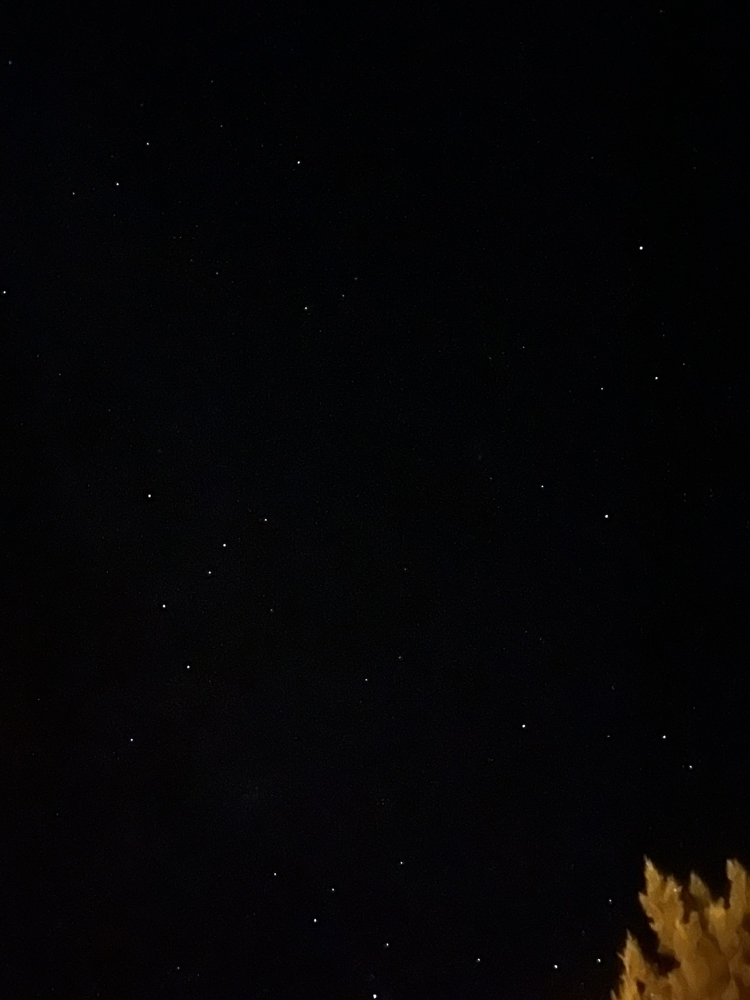
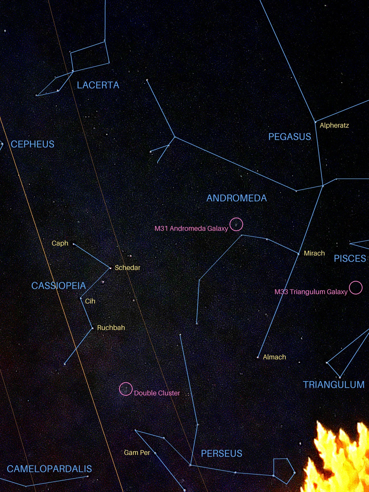
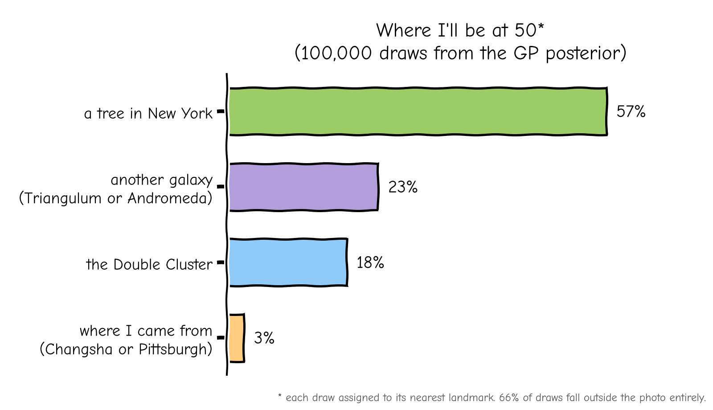

---

I went on a short trip to Utah to try to relax for a bit and work on my long-overdue quarter-life crisis. Living in New York for the past few years, I'm surprised by (or perhaps I simply couldn't validate) how much I enjoyed just looking at stars. I took this picture in my trance, not knowing what to do with this strange feeling.

Perhaps I will feel less lost if I know what these stars are. I've vibe coded a [tool](https://github.com/Aceticia/sky-annotate) and an agent skill so you too can do the same, given a simple picture of a night sky where stars are visible. Here's the result:

Oddly reassuring: this annotation completely resolved my reservations about my future, my waning enjoyment of all my old hobbies, my receding hairline (some say it's not as bad as I make it out to be; I insist to both agree and disagree), and a creeping sense of generalized unease. Inspired by this, I decided to give my own life the same treatment, to combat the occasional empty feeling of being who I am. If stars can be identified from their positions, surely I can too. So I matched the three points of my life I'm sure about to stars whose light left them at the time: GJ 1289 (26.5 light-years) for when I was born in Changsha, Ross 248 (10.3 light-years) for when I left for college in Pittsburgh, and, for New York, the only thing in the frame emitting light that recent, a tree lit by a streetlight. Then I fit a Gaussian process to find out where I'll be at 50:

So, with 95% confidence, at 50 I'll be either on this tree in New York or in the Triangulum Galaxy, 2.7 million light-years away. Changsha and Pittsburgh are, statistically, no longer an option.

To be sure, I drew 100,000 samples from the posterior:

